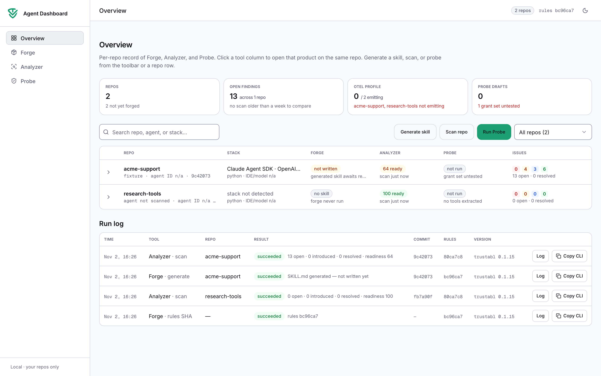

<p align="center">
  <a href="LICENSE"></a>
  <a href="https://github.com/trustabl/agent-dashboard/releases"></a>
  <a href="https://github.com/trustabl/agent-dashboard/stargazers"></a>
  <a href="https://github.com/trustabl/agent-dashboard/actions/workflows/ci.yml"></a>
  <a href="package.json"></a>
  <a href="package.json"></a>
  <br>
  <a href="https://github.com/trustabl/agent-reliability-analyzer"></a>
  <a href="https://github.com/trustabl/agent-network-access-probe"></a>
  <a href="#first-run--5-minutes"></a>
  <a href="README.md"></a>
</p>

# Agent Dashboard

Agent dashboard runs reliability scans, skills and network access probes on your
own repos from one local, single-user web UI. It wraps Trustabl's open-source
**Analyzer**, **Forge** and **Probe**, so you don't have to install any of them.
Policy and telemetry via OpenTelemetry are coming soon.



| Page | Wraps | Commands |
| --- | --- | --- |
| Overview | all of the below | — |
| Forge | [agent-reliability-analyzer](https://github.com/trustabl/agent-reliability-analyzer) | `trustabl forge`, `trustabl forge check` |
| Analyzer | [agent-reliability-analyzer](https://github.com/trustabl/agent-reliability-analyzer) | `trustabl scan` |
| Probe | [agent-network-access-probe](https://github.com/trustabl/agent-network-access-probe) | `autofix fix` |

- Runs on `127.0.0.1` only. There is no login and no user or org model.
- Pinned CLIs: `trustabl` 0.1.16 and `autofix` 0.5.0. `make run` downloads
  them from their GitHub releases and checks their SHA-256
  (`tools.lock.json`). Newer releases can be installed from the Forge,
  Analyzer and Probe pages.
- Your source code stays on your machine. Probe sends tool source only to the
  LLM endpoint you configure.

## First run (≈ 5 minutes)

Requirements: macOS, Linux or WSL2, with `git`, `curl`, `tar` and `make`.
You need Node.js 22.13 or newer; if you don't have it, `make run` installs a
private copy. To run Probe you also need Docker (or OpenShell) and an
OpenAI-compatible LLM endpoint, for example Ollama.

```sh
git clone https://github.com/trustabl/agent-dashboard.git
cd agent-dashboard
make run            # or: ./scripts/run.sh
```

Open http://127.0.0.1:4317 and click **Generate skill**, **Scan repo** or
**Run Probe**. Pick **New local path — agent not built**, enter a folder (for
example `~/src/my-agent`) and click **Start**. The output streams live. The run
keeps going if you close the tab, and you can cancel it at any time. Every run
has **Copy CLI**, which copies the exact command to run in a terminal.

For Probe with a local model:

```sh
ollama serve & ollama pull qwen2.5-coder:32b
# in the dialog: --model qwen2.5-coder:32b, --llm-url http://localhost:11434/v1
```

Cloud models read their key from `OPENAI_API_KEY`, `ANTHROPIC_API_KEY` or
`LLM_API_KEY` in the environment you start the dashboard from. The dashboard never
stores keys.

## Where state lives, and how to wipe it

All state is under `~/.agent-dashboard` (override with
`AGENT_DASHBOARD_HOME`):

| Path | What |
| --- | --- |
| `console.db` | Repos, run history, findings (SQLite) |
| `runs/<id>/` | Each run's command, output and artifacts (`scan.json`, `trustabl.sarif`, `SKILL.md`, `probe.*.json`, `network_policies.draft.yaml`) |
| `bin/` | CLIs, one folder per installed version |
| `cache/` | The CLIs' rule and Probe result caches (Linux/WSL) |

```sh
make wipe           # asks first; WIPE_YES=1 make wipe to skip the prompt
```

This deletes everything above. On macOS it also deletes the CLIs' caches in
`~/Library/Caches/trustabl*`. Your repos are not touched, and neither is any
`SKILL.md` you chose to write into them.

## Development

```sh
make dev            # hot reload on 127.0.0.1:4317
make check          # eslint + tsc + vitest
make e2e            # Playwright against tests/fixtures/repos (Probe cases need Docker)
make parity         # artifacts from a dashboard run == the same CLI run (timestamps masked)
make secrets        # gitleaks, as in CI
```

See [`docs/ARCHITECTURE.md`](docs/ARCHITECTURE.md) for the architecture
(components, API routes, run engine, data layer, conventions).
Contributions: [`CONTRIBUTING.md`](CONTRIBUTING.md).

## License

Apache-2.0. See [`LICENSE`](LICENSE).
